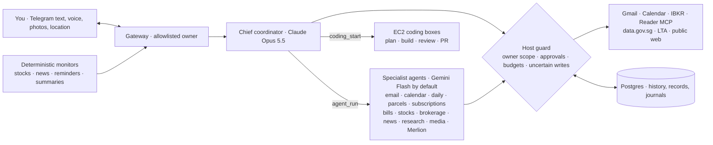

# ◈ Chief

**A personal chief of staff that lives in Telegram.**

Chief keeps one conversation with you, by text or voice, and hands the work to specialist agents: your inbox, calendar, bills, portfolio, reading, local conditions and even its own code. Consequential actions, such as calendar events, coding plans and merges, deletions and new monitoring, wait for your approval. It cannot send email or place trades.

This is a personal project: a self-hosted, single-owner agent, built and run in the open. Current release and open work: [current work](docs/current-work.md) · [releases](https://github.com/akhilvuputuri/chief-agent/releases).

---

## What you can ask it

> _"Find the delivery email for my headphones and track it."_
> _"Add Netflix, 22.98 SGD monthly, renews on the 5th. Remind me three days before."_
> _"Gather last month's invoices from my cloud providers."_
> _"Tell me when VOO closes 15% below its 52-week high."_
> _"Is it going to rain at my pin in the next hour?"_
> _"Every night at 11, research these topics and send me a sourced summary."_
> _"There's a bug in the briefing timezone. Fix it."_

## Features

### 🗣 Conversation that remembers

- Text and **voice notes** in (ElevenLabs, OpenAI or Groq), with optional spoken replies (ElevenLabs or OpenAI).
- **Photos and PDFs**, read by an isolated media agent. Image bytes are never stored.
- A rolling conversation with **history recall**, explicit memories and versioned skills.
- Topics in your private chat: **Main** for conversation, **News**, **Markets** and **Coding** for feeds.
- Phone-friendly **interactive views** (`/status`, `/items`, `/schedules`, `/drafts`, `/briefing`) and a Telegram **Mini App** with revisioned canvases for plans and analyses.

### 📅 Your day, handled

- Tasks, reminders and daily briefings built from the sources you pick.
- **Scheduled routines**: recurring agent runs on any schedule.
- **Responsibilities**: "keep an eye on this". Chief watches the email, calendar or parcels you name, respects quiet hours and only starts once you confirm the card.
- **Gmail, read-only**, across several accounts, with experimental recall of half-remembered emails by meaning. **Calendar** reads, plus event drafts that are created only after you tap approve.
- A **parcel tracker** fed from email or your own updates. Parcel details are searched for only when you ask.

### 💳 Money, tracked

- A **subscription tracker** with renewal reminders, price-change alerts and a monthly summary.
- **Invoice gathering**: original PDFs from Gmail, files you send or billing portals. For portals, you log in yourself in an isolated browser handoff, and Chief never sees your password.
- **Portfolio**: read-only IBKR holdings, stock lookups, daily-drop alerts and "tell me when…" price rules.
- **IBKR order drafts** that you review and submit in IBKR. Chief can't place, change or cancel an order.

### 📰 Reading and research

- A **daily news bulletin** from sites you follow. Each item has a Save-to-Reader button, and building an edition makes no model call. Ranking from your Reader saves turns on once Reader exposes them.
- **Evidence-checked research**: every quote in an agent's report must appear in a source it actually read.
- Public link resolution, plus NLB library ebook availability.
- **Job search**: saved roles, fit assessments that keep unknowns visible, and preparation tied to evidence.

### 🇸🇬 Merlion, the Singapore agent

Weather, rain radar (with maps and loops for a shared location), PSI and US AQI, alerts, carparks, traffic cameras, bus arrivals, MRT status, holidays and hawker closures, all from data.gov.sg and LTA DataMall.

### 🛠 Chief builds Chief

Describe a bug or feature in plain words. Chief writes a plan, and nothing is built until you approve it. A coding agent then implements it in a disposable **EC2 box**, runs the real checks and gets a separate reviewer model to review it. It then opens a PR and works through review feedback. Chief merges only after you tap Merge on a card for that exact PR head, then watches the release.

## How it stays in your control

| Principle                                | In practice                                                                                                                                             |
| ---------------------------------------- | ------------------------------------------------------------------------------------------------------------------------------------------------------- |
| **The model proposes, the host decides** | Identity comes from Telegram authentication, never from model arguments. Every tool has a strict schema and is scoped to you.                           |
| **Approval for consequential actions**   | Calendar events, coding plans and merges, role deletions and new monitoring all wait for a bound Telegram card or reply.                                |
| **Read-only by default**                 | Gmail and IBKR holdings are read-only. There is no email sending, and orders are only drafts.                                                           |
| **No silent retries**                    | A write whose outcome is uncertain pauses for inspection instead of running twice.                                                                      |
| **Bounded work**                         | Every task has time, model-call and tool-call allowances. You can check, continue or cancel it with `/status`, `/continue` and `/workcancel`.           |
| **Deterministic where possible**         | Stock alerts, news editions, reminders and monthly summaries are plain code, with no model in the loop.                                                 |
| **Isolated agents**                      | Agents get a brief, not your conversation. Agents can't start other agents, and untrusted code runs only in throwaway boxes without production secrets. |
| **Private logs**                         | Operational logs carry IDs, counts and codes, never message text, email or tokens.                                                                      |

Details: [security](docs/security.md), [calendar approval](docs/calendar-approval.md), [reliable execution](docs/reliable-execution.md), [operational logs](docs/operational-logs.md).

## How it works



- **Coordinator and agents.** Chief keeps the conversation, memory and work tracking. Domain work runs in [plugin-defined agents](docs/agents.md) with their own context, tools and, by default, a cheaper model. Their reports are validated against a contract before Chief sees them.
- **Models are configuration.** [`config/model-policy.json`](config/model-policy.json) maps the main model and agent tiers, and is changed through review and release like any code. A small decision model picks the [reasoning effort](docs/reasoning-effort.md) for each message.
- **Durable by design.** Model responses and tool calls are journalled before the turn advances. Background jobs keep their own context while chat stays responsive. See [rolling conversation](docs/rolling-conversation.md).
- **Extensible.** Add agents as [declarative plugins](docs/plugins.md) and remote tools through [MCP connectors](docs/mcp.md), each with explicit tool grants.

## Status

| Area                                                            | Status                                                       |
| --------------------------------------------------------------- | ------------------------------------------------------------ |
| Conversation, voice, attachments, topics, views, canvases       | Live                                                         |
| Tasks, reminders, briefings, routines, responsibilities         | Live                                                         |
| Gmail (read-only), Calendar with approved drafts, parcels       | Live                                                         |
| Email recall by meaning                                         | Experimental; merged, under evaluation                       |
| Subscriptions, invoice gathering, price alerts, monthly summary | Live; newest parts awaiting real-use checks                  |
| IBKR holdings and order drafts, stock alerts and rules          | Live; needs your IBKR consent and a market-data key          |
| News bulletin, research, job alignment                          | Live; Reader-based ranking pending                           |
| Merlion (Singapore)                                             | Live; awaiting real-use checks                               |
| Coding on EC2 boxes, merge on your tap                          | Live                                                         |
| NLB library account linking                                     | Blocked by provider API access; catalogue availability works |

Status describes released code, not experiments. It is not a measure of answer quality. The project publishes quality, latency or cost numbers only once they've been measured; see the [roadmap](docs/roadmap.md#evaluation-before-marketing-claims).

## Run your own

Requires Node 22.19+ (`.nvmrc` pins the tested version) and Docker Compose. Every integration beyond Telegram and a model provider is optional. The full check suite also covers the coding workers; see [portable development](docs/portable-development.md).

```sh
npm ci
npm run setup              # creates a private .env with database credentials
# Edit .env: set TELEGRAM_BOT_TOKEN and OPENROUTER_API_KEY. Never commit it.
docker compose up -d postgres
docker compose run --rm migrate
npm run pair               # then press Start in the link it prints
npm run pair:finish        # saves your Telegram user ID to .env
npm run check:env
npm run dev
```

Production runs the same Compose stack (`docker compose up -d --build`): a gateway and Postgres, both bound to loopback. An optional `gathering` profile adds the isolated invoice browser and its egress proxy. Guides: [deployment](docs/deployment.md), [configuration](docs/configuration.md), [Google](docs/google-integrations.md), [voice](docs/voice-setup.md), [IBKR](docs/ibkr-portfolio.md), [Singapore data](docs/singapore-open-data.md), [troubleshooting](docs/troubleshooting.md).

## Built in the open

The [engineering journal](docs/journey/README.md) has more than a hundred entries on decisions, production incidents and experiments. Each one keeps measured results apart from hypotheses. Good starting points: [owning the runtime](docs/journey/01-owned-runtime.md), [token cost](docs/journey/03-token-cost.md), [coordinator agents](docs/journey/49-coordinator-agents.md) and [boxed sub-agents](docs/journey/91-boxed-subagents.md).

```sh
npm run check && npm run build && npm run format:check   # mocked; no production keys needed
```

## Contributing

Human and coding-agent contributors start with [AGENTS.md](AGENTS.md), [CONTRIBUTING.md](CONTRIBUTING.md), [current work](docs/current-work.md) and [portable development](docs/portable-development.md). Merging to `main` triggers checks and then an automatic release; see [cloud development](docs/cloud-development.md) and the [release policy](docs/releases.md).

## Attribution

Chief was formerly Companion Agent; stable operational identifiers are listed in [rebranding](docs/rebranding.md). The first prototype used [Nous Research Hermes Agent](https://github.com/NousResearch/hermes-agent/tree/9c4c548cd555905563b146a6974932b0c5eb8a01). Chief now runs its own TypeScript runtime, and the removed adapter remains in Git history at `489f73e`. MIT licensed.
